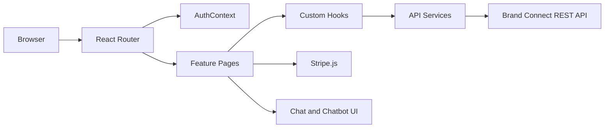

# Brand Connect Frontend

React and Vite interface for Brand Connect, a marketplace for brands and content creators.

The frontend provides account registration and login, TOTP MFA, creator and client profiles, marketplace browsing, cart and checkout flows, Stripe result states, chat, chatbot support, and an administrative dashboard.

## Live Demo

- [GitHub Pages deployment](https://andrescontreras1034.github.io/Frontend-brandconnect/)
- [Brand Connect production site](https://brandconnect.social)
- [Backend repository](https://github.com/AndresContreras1034/backend-brandconnect)

## Implemented Features

- Email registration and login
- JWT session persistence
- Email verification flow
- TOTP MFA setup and verification
- Protected React routes
- Creator and client onboarding
- Creator profiles and social links
- Marketplace browsing and recommendations
- Cart and checkout interface
- Stripe payment history and result pages
- Creator chat and negotiation interfaces
- Support chatbot
- Administration dashboard
- Pricing, status, legal, and support pages

## Architecture



Authentication state is handled by `AuthContext`, route protection is implemented in `AppRouter`, and API communication is isolated in the `src/services` layer.

## Technology Stack

| Technology | Role |
|---|---|
| React 18 | UI components |
| Vite | Development server and build |
| React Router | Application routing and guards |
| Context API | Authentication state |
| Axios | HTTP API requests |
| Stripe.js | Checkout integration |
| QRCode React | TOTP setup |
| Framer Motion | Interface animation |
| Lucide React | Icons |
| Socket.IO Client | Real-time client support |
| CSS | Feature-level styling |

## Project Structure

```text
src/
  assets/                 Static images and media
  components/             Reusable UI and feature components
  context/                Authentication context
  hooks/                  Reusable API and state hooks
  layout/                 Shared application layout
  pages/                  Route-level views
  routes/AppRouter.jsx    Route configuration and guards
  services/               Backend API clients
  styles/                 Shared CSS
  utils/                  Formatting and validation helpers
public/                   Static files and SPA fallback
.github/workflows/        Azure Static Web Apps deployment
```

## Requirements

- Node.js 20 or newer
- npm
- An accessible Brand Connect API

## Environment Variables

Copy `.env.example` to `.env.local`:

```dotenv
VITE_API_URL=http://localhost:3000/api
```

For the production API:

```dotenv
VITE_API_URL=https://api.brandconnect.social/api
```

The variable is read by Vite and must start with `VITE_`.

## Installation

```powershell
npm install
npm run dev
```

The development server runs on port `5173`.

## Available Commands

```powershell
npm run dev
npm run build
npm run lint
npm run preview
```

## Backend Integration

The frontend consumes the Brand Connect REST API for authentication, profiles, marketplace operations, chat, chatbot, payments, subscriptions, fulfillment, and administration.

Set `VITE_API_URL` to the API base URL. The API origin must also allow the frontend origin through CORS.

## Stripe

Stripe.js is used for browser-side checkout integration. Payment completion and cancellation states are handled by dedicated result routes.

Stripe secrets must remain in the backend. The frontend should only contain publishable or public configuration.

## Deployment

The repository includes an Azure Static Web Apps workflow in `.github/workflows`.

For a static deployment:

1. Configure `VITE_API_URL`.
2. Run `npm run build`.
3. Publish the `dist` directory.
4. Configure SPA fallback for React Router routes.
5. Configure CORS in the backend for the deployed frontend origin.

The GitHub Pages deployment may require repository-base-path configuration depending on the final domain.

## Known Limitations

- Automated frontend tests are not included.
- Route and component mocks are not part of the repository.
- Several pages depend on a running backend and external services.
- Browser authentication state is stored in local storage.
- The frontend should add route-level lazy loading and component refactoring before scaling to a large team.
- The live backend and third-party services determine whether payment and chatbot flows are usable.

## Security

- Never place Stripe secret keys or backend credentials in `VITE_*` variables.
- Keep JWT values and user data outside application logs.
- Validate authentication and authorization in the backend; frontend route guards improve UX but do not secure the API.
- Review external API responses before rendering dynamic content.
